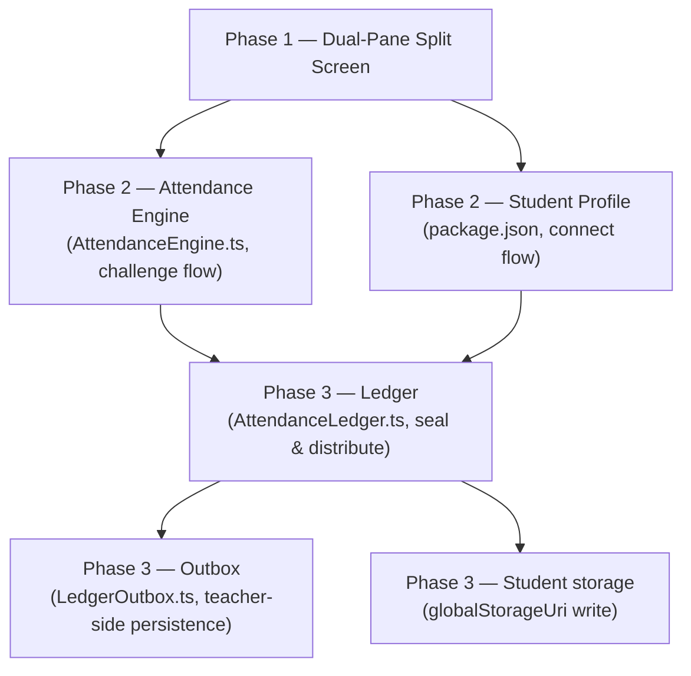

# Classroom Code Sync — Implementation Plan: Phases 1, 2 & 3

> [!NOTE]
> This plan is grounded in the current codebase. Every file path, interface name, and enum value references what already exists. No new external packages are needed except Node's built-in `crypto` module (already available).

---

## Phase 1: Dual-Pane Split-Screen with Live Cursor & Selection

**Goal:** Replace the single read-only virtual tab with two side-by-side panes. The left pane (*Total Code*) lets the student scroll freely. The right pane (*Live Focus*) tracks the teacher's cursor in real time, highlights their active line and selection, and auto-scrolls to stay on target.

---

### 1.1 Extend the Wire Protocol — `messages.ts`

**File:** `src/extension/types/messages.ts`

Add a `selection` field to both `FileUpdateMessage` and `FileSwitchMessage`, and add a new `CURSOR_MOVE` message type for lightweight real-time tracking (no full content on every cursor move).

```ts
// New enum value
CURSOR_MOVE = 'cursor_move',

// Add to FileUpdateMessage & FileSwitchMessage
selection?: {
  anchor: { line: number; character: number };
  active: { line: number; character: number };
};

// New message: Teacher → Students (cursor-only update, no content)
export interface CursorMoveMessage extends BaseMessage {
  type: MessageType.CURSOR_MOVE;
  line: number;
  character: number;
  selection?: {
    anchor: { line: number; character: number };
    active: { line: number; character: number };
  };
}

// Add CursorMoveMessage to TeacherMessage union
```

---

### 1.2 Broadcast Cursor Moves — `FileSyncManager.ts`

**File:** `src/extension/sync/FileSyncManager.ts`

Listen to `vscode.window.onDidChangeTextEditorSelection`. Throttle to max 1 message per 50ms (avoid flooding on rapid arrow-key navigation).

```
New subscription in start():
  vscode.window.onDidChangeTextEditorSelection(event => {
    // Only for the active, currently-synced editor
    if (event.textEditor.document.uri !== currentDocument?.uri) return;
    throttle(() => {
      messageBroker.broadcastCursorMove(
        event.selections[0].active.line,
        event.selections[0].active.character,
        {
          anchor: event.selections[0].anchor,
          active:  event.selections[0].active,
        }
      );
    }, 50);
  })
```

Also update `syncFileSwitch` and `syncFileUpdate` to pass the full selection (anchor + active) instead of just the cursor point.

---

### 1.3 New Broker Method — `MessageBroker.ts`

**File:** `src/extension/server/MessageBroker.ts`

```ts
broadcastCursorMove(line: number, character: number, selection?: ...): void
```

---

### 1.4 Two-URI Virtual Document Provider — `VirtualDocumentProvider.ts`

**File:** `src/extension/client/VirtualDocumentProvider.ts`

Currently there is one URI (`classroom-sync://<fileName>`). Extend to two stable URIs per file:

| Pane | URI | Behaviour |
|:---|:---|:---|
| Total Code | `classroom-sync-total://<fileName>` | Full file, scheme `classroom-sync-total` |
| Live Focus | `classroom-sync-focus://<fileName>` | Full file, scheme `classroom-sync-focus` |

Both show the same content. The difference is only in how the student editor decorates and scrolls the Live Focus pane.

**Changes:**
- Register **two** `TextDocumentContentProvider` instances in `extension.ts`, one per scheme.
- Both share the same underlying content buffer — `update()` fires `_onDidChange` on both URIs simultaneously.
- Expose `totalUri` and `focusUri` getters.

---

### 1.5 Decoration Manager — `src/extension/client/DecorationManager.ts` *(new file)*

This service owns all `TextEditorDecorationType` instances for the Live Focus pane.

```
DecorationManager
  ├── activeLine: TextEditorDecorationType  (yellow left border + subtle background)
  ├── selection:  TextEditorDecorationType  (blue highlight matching VS Code theme)
  └── apply(editor, line, selection): void
       1. Clear previous decorations
       2. Apply activeLine decoration to the teacher's cursor line
       3. Apply selection decoration if anchor ≠ active
       4. editor.revealRange(cursorRange, TextEditorRevealType.InCenterIfOutsideViewport)
```

---

### 1.6 Student Connect Flow — `extension.ts`

**File:** `src/extension/extension.ts`

Replace the current `onFileUpdate` handler in `connectAsStudent()`:

```
Current:  opens one virtual doc in ViewColumn.Active
New:
  1. First file update → open Total Code (ViewColumn.One) and Live Focus (ViewColumn.Two)
  2. Subsequent file updates → update content of both URIs (fires onDidChange, VS Code reloads)
  3. CursorMove message → DecorationManager.apply(liveFocusEditor, line, selection)
```

Add `onCursorMove` callback to `WebSocketClient`.

---

### 1.7 WebSocketClient — `WebSocketClient.ts`

**File:** `src/extension/client/WebSocketClient.ts`

```ts
// New callback type
type CursorMoveListener = (line: number, char: number, selection?: ...) => void;

// In message handler:
} else if (msg.type === 'cursor_move') {
  this.cursorMoveListeners.forEach(l => l(msg.line, msg.character, msg.selection));
}

// New public method
onCursorMove(listener: CursorMoveListener): void
```

---

### Phase 1 — Files Changed / Created

| Action | File |
|:---|:---|
| Modify | `src/extension/types/messages.ts` |
| Modify | `src/extension/sync/FileSyncManager.ts` |
| Modify | `src/extension/server/MessageBroker.ts` |
| Modify | `src/extension/client/VirtualDocumentProvider.ts` |
| **Create** | `src/extension/client/DecorationManager.ts` |
| Modify | `src/extension/client/WebSocketClient.ts` |
| Modify | `src/extension/extension.ts` |

---

---

## Phase 2: Hardware-Bound Attendance & Randomized Check-In

**Goal:** Collect tamper-resistant attendance automatically during the lecture. Each student is permanently linked to their laptop via `vscode.env.machineId`. The teacher triggers a silent challenge at a random moment; only students who are live and running VS Code pass.

---

### 2.1 Student Profile Setup

**File:** `src/extension/extension.ts`

On first connect (`connectAsStudent`), if `classroomSync.student.name` or `classroomSync.student.id` are empty strings, prompt the student before proceeding:

```
vscode.window.showInputBox({ prompt: 'Enter your full name', placeHolder: 'Jane Doe' })
vscode.window.showInputBox({ prompt: 'Enter your Matriculation ID', placeHolder: 'CSC/2022/0142' })
// Save to global config (ConfigurationTarget.Global)
```

New command `classroomSync.student.updateProfile` → re-runs the same prompts at any time.

---

### 2.2 New Package Settings — `package.json`

Add to `contributes.configuration.properties`:

```json
"classroomSync.student.name":        { "type": "string",  "default": "" },
"classroomSync.student.id":          { "type": "string",  "default": "" },
"classroomSync.attendance.serverUrl":{ "type": "string",  "default": "" },
"classroomSync.attendance.randomMin":{ "type": "number",  "default": 5  },
"classroomSync.attendance.randomMax":{ "type": "number",  "default": 30 }
```

Add to `contributes.commands`:

```json
{ "command": "classroomSync.teacher.triggerAttendance", "title": "Classroom: Trigger Attendance Check-In (Teacher)" },
{ "command": "classroomSync.student.updateProfile",     "title": "Classroom: Update My Profile (Student)" }
```

---

### 2.3 Extend the Wire Protocol — `messages.ts`

New message types:

```ts
// Teacher → Students
ATTENDANCE_CHALLENGE = 'attendance_challenge',
ATTENDANCE_CONFIRMED = 'attendance_confirmed',

// Students → Teacher
ATTENDANCE_RESPONSE  = 'attendance_response',
```

```ts
export interface AttendanceChallengeMessage extends BaseMessage {
  type: MessageType.ATTENDANCE_CHALLENGE;
  nonce: string;         // random token generated per challenge
  sessionId: string;
}

export interface AttendanceResponseMessage extends BaseMessage {
  type: MessageType.ATTENDANCE_RESPONSE;
  nonce: string;
  studentName: string;
  studentId: string;
  machineId: string;     // vscode.env.machineId
  hmac: string;          // HMAC-SHA256(nonce + machineId + studentId, nonce) — anti-replay
}

export interface AttendanceConfirmedMessage extends BaseMessage {
  type: MessageType.ATTENDANCE_CONFIRMED;
  studentName: string;
  status: 'accepted' | 'rejected';
  reason?: string;       // e.g. 'duplicate_machine'
}
```

---

### 2.4 Attendance Engine — `src/extension/server/AttendanceEngine.ts` *(new file)*

```
AttendanceEngine
  ├── sessionId: string
  ├── checkedIn: Map<machineId → { studentName, studentId, timestamp, hmac }>
  ├── challengeNonce: string | null
  ├── randomTimer: NodeJS.Timeout
  │
  ├── start(randomMinMs, randomMaxMs): void
  │     Schedules one random challenge between randomMin and randomMax
  │
  ├── triggerChallenge(): string   (returns nonce)
  │     1. Generate nonce = crypto.randomBytes(16).toString('hex')
  │     2. Store as this.challengeNonce
  │     3. Set 60-second expiry timer (nonce expires)
  │     4. Return nonce (caller broadcasts the challenge)
  │
  ├── processResponse(response: AttendanceResponseMessage): 'accepted' | 'rejected'
  │     1. If nonce expired or doesn't match → reject
  │     2. Verify HMAC
  │     3. If machineId already in checkedIn → reject 'duplicate_machine'
  │     4. Otherwise → record in checkedIn, return 'accepted'
  │
  └── getAttendanceSnapshot(): AttendanceRecord[]
```

---

### 2.5 Teacher: Challenge Trigger & Connection Panel Update

**File:** `src/extension/server/WebSocketServer.ts`

- Instantiate `AttendanceEngine` in the constructor alongside `ConnectionManager`.
- Expose `getAttendanceEngine()` accessor.
- In `handleStudentMessage`, route `ATTENDANCE_RESPONSE` to `AttendanceEngine.processResponse()`, then `broadcastAttendanceConfirmed()` back to that specific client.

**File:** `src/extension/ui/ConnectionPanel.ts`

- Add an **"Attendance"** card to the teacher panel showing: `X / Y checked in`.
- Add a **"Trigger Attendance Now"** button that posts `triggerAttendance` to the extension.
- Poll attendance count every 2s via the existing `setInterval` update loop.

**File:** `src/extension/extension.ts`

- Register `classroomSync.teacher.triggerAttendance`:
  ```ts
  const nonce = serverInstance.getAttendanceEngine().triggerChallenge();
  serverInstance.getMessageBroker().broadcastAttendanceChallenge(nonce, sessionId);
  ```

---

### 2.6 Student: Respond to Challenge — `WebSocketClient.ts`

```ts
} else if (msg.type === 'attendance_challenge') {
  const cfg = vscode.workspace.getConfiguration('classroomSync.student');
  const name = cfg.get<string>('name', '');
  const id   = cfg.get<string>('id', '');
  if (!name || !id) {
    // Silently skip — student has not set up profile
    return;
  }
  const machineId = vscode.env.machineId;
  const hmac = computeHmac(msg.nonce, machineId, id); // crypto.createHmac
  this.ws.send(JSON.stringify({
    type: 'attendance_response',
    nonce: msg.nonce,
    studentName: name,
    studentId: id,
    machineId,
    hmac,
    timestamp: Date.now(),
  }));
}
```

> [!IMPORTANT]
> The HMAC uses the nonce as the key and `nonce + machineId + studentId` as the data. This binds the response to the specific challenge and the specific machine, preventing a student from replaying a previous valid response.

---

### Phase 2 — Files Changed / Created

| Action | File |
|:---|:---|
| Modify | `src/extension/types/messages.ts` |
| **Create** | `src/extension/server/AttendanceEngine.ts` |
| Modify | `src/extension/server/WebSocketServer.ts` |
| Modify | `src/extension/server/MessageBroker.ts` |
| Modify | `src/extension/ui/ConnectionPanel.ts` |
| Modify | `src/extension/client/WebSocketClient.ts` |
| Modify | `src/extension/extension.ts` |
| Modify | `package.json` |

---

---

## Phase 3: Cryptographic Distributed Ledger ("Everyone Carries the Ledger")

**Goal:** When the teacher stops the session, generate a cryptographically sealed attendance record that is simultaneously stored on every student's laptop. Each record is linked in a SHA-256 hash chain so any tampering by any party is immediately detectable.

---

### 3.1 Ledger Data Model — `src/extension/server/AttendanceLedger.ts` *(new file)*

```ts
export interface LedgerEntry {
  index:       number;        // 0-based sequential index
  timestamp:   number;        // Unix ms
  studentName: string;
  studentId:   string;
  machineId:   string;
  sessionId:   string;
  prevHash:    string;        // SHA-256 of previous LedgerEntry (genesis = '0'.repeat(64))
  hash:        string;        // SHA-256(prevHash + studentId + machineId + timestamp)
}

export interface SealedLedger {
  sessionId:   string;
  date:        string;        // ISO 8601 (e.g. 2026-11-04)
  teacherHash: string;        // Teacher's machineId (hashed for privacy)
  entries:     LedgerEntry[];
  sealHash:    string;        // SHA-256 of JSON.stringify(entries)
  sealedAt:    number;
}
```

```
AttendanceLedger
  ├── entries: LedgerEntry[]  (private)
  │
  ├── append(studentName, studentId, machineId, sessionId): LedgerEntry
  │     1. prevHash = last entry's hash OR genesis hash
  │     2. hash = SHA-256(prevHash + studentId + machineId + timestamp)
  │     3. Push LedgerEntry, return it
  │
  ├── seal(sessionId, teacherMachineId): SealedLedger
  │     1. sealHash = SHA-256(JSON.stringify(this.entries))
  │     2. Return SealedLedger object
  │
  └── verify(sealed: SealedLedger): boolean
        Walk entries, re-compute each hash, verify chain integrity + sealHash
```

---

### 3.2 Wire Integration — `messages.ts`

```ts
// Teacher → ALL Students (broadcast on session stop)
LEDGER_SEALED = 'ledger_sealed',

export interface LedgerSealedMessage extends BaseMessage {
  type: MessageType.LEDGER_SEALED;
  ledger: SealedLedger;
}
```

---

### 3.3 Teacher: Seal & Broadcast on Stop

**File:** `src/extension/server/WebSocketServer.ts` / `AttendanceEngine.ts`

In `AttendanceEngine`, after `processResponse()` accepts a student, call:
```ts
this.ledger.append(studentName, studentId, machineId, this.sessionId);
```

**File:** `src/extension/extension.ts` — `stopTeacherServer()`

```ts
// 1. Seal the ledger
const engine = serverInstance.getAttendanceEngine();
const sealed = engine.seal(sessionId, vscode.env.machineId);

// 2. Broadcast to all students before disconnecting
messageBroker.broadcastLedgerSealed(sealed);
await new Promise(r => setTimeout(r, 1000)); // allow delivery

// 3. Save locally to teacher's globalStorageUri (outbox for Phase 4)
await saveLedgerToOutbox(context, sealed);

// 4. Proceed with server.stop() as normal
```

---

### 3.4 Outbox Storage — `src/extension/server/LedgerOutbox.ts` *(new file)*

```
LedgerOutbox
  ├── save(context, sealed: SealedLedger): Promise<void>
  │     path = context.globalStorageUri/outbox/<sessionId>.json
  │     Encrypts with a simple XOR-with-machineId key (or stores plain JSON for v1)
  │     Writes atomically via vscode.workspace.fs.writeFile
  │
  ├── list(context): Promise<SealedLedger[]>
  │     Reads all .json files from outbox/
  │
  └── markSent(context, sessionId): Promise<void>
        Moves file from outbox/ to outbox/sent/
```

> [!NOTE]
> Phase 4 (Automatic Dispatcher) will add the network upload. `LedgerOutbox` is designed to work standalone so Phase 4 only needs to add the HTTP POST logic on top.

---

### 3.5 Student: Receive & Persist Ledger — `WebSocketClient.ts`

```ts
} else if (msg.type === 'ledger_sealed') {
  this.ledgerSealedListeners.forEach(l => l(msg.ledger));
}
```

**File:** `src/extension/extension.ts` — `connectAsStudent()` handler:

```ts
studentClient.onLedgerSealed(async (ledger) => {
  // 1. Verify chain integrity before storing
  if (!AttendanceLedger.verify(ledger)) {
    vscode.window.showWarningMessage('Received attendance ledger failed integrity check!');
    return;
  }
  // 2. Save to student's globalStorageUri/attendance/<date>_<sessionId>.json
  const path = vscode.Uri.joinPath(
    context.globalStorageUri,
    'attendance',
    `${ledger.date}_${ledger.sessionId}.json`
  );
  const data = Buffer.from(JSON.stringify(ledger, null, 2));
  await vscode.workspace.fs.writeFile(path, data);
  vscode.window.showInformationMessage(
    `✅ Attendance ledger saved. ${ledger.entries.length} student(s) recorded.`
  );
});
```

---

### 3.6 Teacher Panel: Show Ledger Status

**File:** `src/extension/ui/ConnectionPanel.ts`

Add to the connection panel:
- **Ledger Hash** (first 12 chars of latest `sealHash` or the growing chain tip while session is live), shown as a monospace badge.
- **"View Ledger"** button that opens a VS Code Output Channel with a pretty-printed attendance list when clicked.

---

### Phase 3 — Files Changed / Created

| Action | File |
|:---|:---|
| Modify | `src/extension/types/messages.ts` |
| **Create** | `src/extension/server/AttendanceLedger.ts` |
| **Create** | `src/extension/server/LedgerOutbox.ts` |
| Modify | `src/extension/server/AttendanceEngine.ts` |
| Modify | `src/extension/server/MessageBroker.ts` |
| Modify | `src/extension/client/WebSocketClient.ts` |
| Modify | `src/extension/ui/ConnectionPanel.ts` |
| Modify | `src/extension/extension.ts` |

---

---

## Execution Order & Dependencies



> [!TIP]
> Phase 1 and Phase 2 are mostly independent and can be developed in parallel. Phase 3 strictly depends on Phase 2's `AttendanceEngine` being complete since it appends to the ledger as check-ins arrive.

---

## New Files Summary

| File | Phase | Purpose |
|:---|:---|:---|
| `src/extension/client/DecorationManager.ts` | 1 | Applies line & selection decorations to Live Focus pane |
| `src/extension/server/AttendanceEngine.ts` | 2 | Challenge/response state machine, duplicate-machine detection |
| `src/extension/server/AttendanceLedger.ts` | 3 | SHA-256 append-only hash chain, verify & seal |
| `src/extension/server/LedgerOutbox.ts` | 3 | Persists sealed ledger JSON for offline dispatch (Phase 4 hook) |

## Modified Files Summary

| File | Phases |
|:---|:---|
| `src/extension/types/messages.ts` | 1, 2, 3 |
| `src/extension/sync/FileSyncManager.ts` | 1 |
| `src/extension/server/MessageBroker.ts` | 1, 2, 3 |
| `src/extension/server/WebSocketServer.ts` | 2, 3 |
| `src/extension/client/VirtualDocumentProvider.ts` | 1 |
| `src/extension/client/WebSocketClient.ts` | 1, 2, 3 |
| `src/extension/ui/ConnectionPanel.ts` | 2, 3 |
| `src/extension/extension.ts` | 1, 2, 3 |
| `package.json` | 2 |
